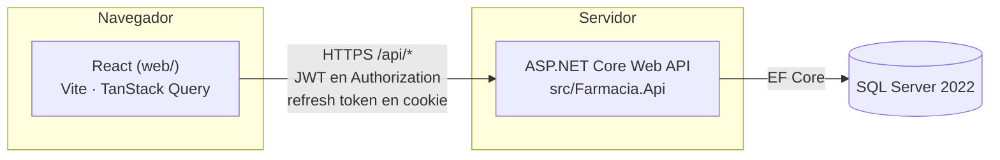
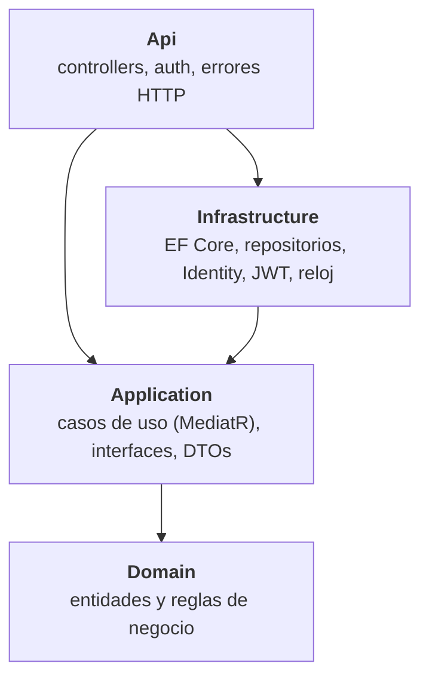
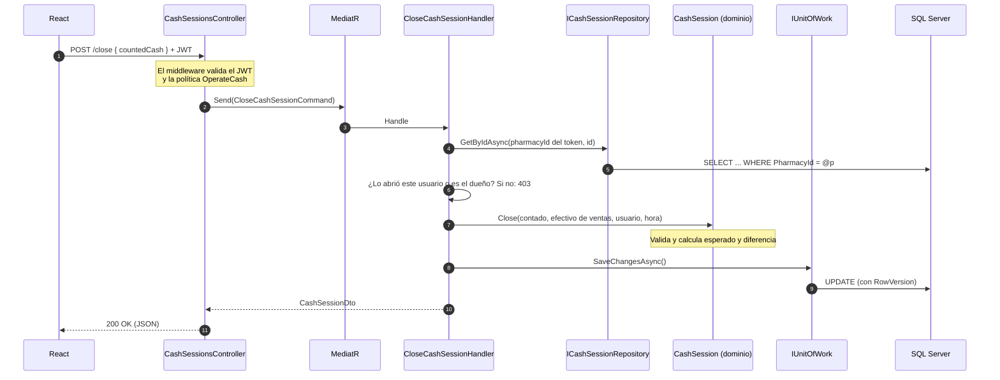

# Arquitectura

## Visión general



En desarrollo, Vite sirve el frontend en el puerto 5173 y reenvía (proxy) `/api`, `/hubs` y `/health` a la API en el 5228. Así el navegador ve un solo origen, no hace falta configurar CORS y la cookie `SameSite=Strict` funciona igual que en producción.

En producción hay **un solo contenedor**: la API sirve también el build de React desde `wwwroot`, en el mismo origen. Las migraciones van en una imagen aparte que se ejecuta antes de desplegar la app. Ver [ADR 0019](adr/0019-un-contenedor-para-api-y-frontend.md).

## Clean Architecture: cuatro proyectos y una regla



**Regla de dependencias: siempre hacia adentro.** `Domain` no conoce a nadie. `Application` conoce a `Domain` y define **interfaces** (`IProductRepository`, `IClock`, `ICurrentUser`…) que implementan las capas de afuera. Así:

- **Las reglas de negocio se prueban sin base de datos.** Por ejemplo, el costo real de una compra o la diferencia de caja: los tests del dominio corren en milisegundos.
- **El POS offline de la fase 6 puede reutilizar el dominio**, porque no depende de SQL Server ni de HTTP.
- **Cambiar la tecnología de afuera no toca las reglas.** Pasar de SQL Server a otra base, o de controllers a otra cosa, no cambia `Domain` ni `Application`.

| Proyecto | Contiene | No debe contener |
|---|---|---|
| `Farmacia.Domain` | Entidades, value objects (`Nit`), servicios de dominio (`FefoAllocator`), `DomainException` | EF Core, atributos de persistencia, `DateTime.Now`, HTTP |
| `Farmacia.Application` | Un caso de uso por acción (command o query + handler), DTOs, interfaces de repositorios y servicios, excepciones de caso de uso | EF Core, SQL, `HttpContext` |
| `Farmacia.Infrastructure` | `FarmaciaDbContext`, configuraciones Fluent API, migraciones, repositorios, Identity, emisión de JWT, `ColombiaClock` | Reglas de negocio |
| `Farmacia.Api` | Controllers delgados, políticas de autorización, traducción de excepciones a HTTP, OpenAPI | Lógica de negocio o consultas |

## El recorrido de una petición

Ejemplo: un cajero cierra su turno (`POST /api/cash-sessions/{id}/close`).



Puntos clave:

1. **El controller no tiene lógica.** Arma el command y lo envía con `ISender`.
2. **La farmacia y el usuario nunca vienen del body.** Salen del JWT firmado, mediante `ICurrentPharmacy` e `ICurrentUser`.
3. **Las reglas del modelo están en el dominio** (`CashSession.Close`). Las reglas que dependen de quién pide o de otros datos están en el handler (por ejemplo, "¿este turno es suyo?").
4. **Un caso de uso hace un solo `SaveChanges`, que es una sola transacción.** Por ejemplo, confirmar una compra guarda la compra, los lotes y el kardex juntos, o no guarda nada.

## CQRS con MediatR

Cada acción del sistema es una clase: un **command** cuando cambia datos (`ConfirmPurchaseCommand`) o una **query** cuando solo lee (`GetCurrentCashSessionQuery`), con su handler en el mismo archivo. Los archivos se agrupan por funcionalidad, no por tipo técnico:

```
Application/Purchases/ConfirmPurchase/ConfirmPurchase.cs   ← command + handler juntos
```

Así, para entender o cambiar "confirmar compra" se abre un solo archivo. MediatR se usa en su edición Community (ver [ADR 0004](adr/0004-mediatr-community.md)).

## Errores: de excepción a HTTP

Las capas internas lanzan excepciones con significado, y `ProblemDetailsExceptionHandler` (Api) las traduce a respuestas [ProblemDetails (RFC 9457)](https://www.rfc-editor.org/rfc/rfc9457):

| Excepción | Dónde se lanza | HTTP |
|---|---|---|
| `DomainException` | Dominio: se violó una regla del modelo | 400 |
| `ValidationException` | Caso de uso: la petición no tiene sentido (p. ej. el proveedor no existe) | 400 |
| `UnauthorizedException` | Credenciales o sesión inválidas | 401 |
| `ForbiddenException` | La acción no le corresponde a este usuario (p. ej. cerrar el turno de otro cajero) | 403 |
| `NotFoundException` | No existe **en esta farmacia** | 404 |
| `ConflictException` | Choca con datos existentes: duplicado, concurrencia, turno ya abierto | 409 |
| Cualquier otra | Error inesperado | 500, sin detalles internos |

Los mensajes están en español porque los lee el usuario final.

## Decisiones transversales

- **Ids `Guid` v7 generados en el dominio.** El POS offline podrá crear registros sin conexión y sin choques al sincronizar ([ADR 0002](adr/0002-ids-guid-v7-en-el-dominio.md)).
- **`PharmacyId` en toda entidad del negocio**, desde el inicio, para el multi-tenant ([ADR 0003](adr/0003-pharmacyid-desde-el-inicio.md)).
- **El tiempo viene de `IClock`**, con hora de Colombia fija en UTC-5 (Colombia no tiene horario de verano). Ni el dominio ni el cliente deciden "ahora": así nadie registra una recepción con una fecha inventada.
- **Concurrencia optimista con `RowVersion`** en `Batch`, `Purchase` y `CashSession`. Dos operaciones simultáneas sobre lo mismo no se pisan: la segunda recibe un 409.
- **Los índices únicos son la última defensa.** El caso de uso verifica primero para dar un mensaje claro, pero dos peticiones simultáneas pueden pasar esa verificación; la base de datos rechaza la segunda.
