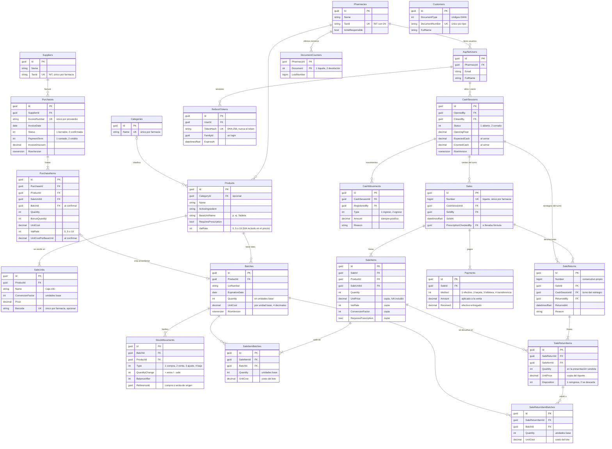

# Base de datos

SQL Server 2022. En desarrollo corre en Docker en el puerto **14330** (no en el 1433, para no chocar con un SQL Server instalado en la máquina). El esquema lo define EF Core con Fluent API (`Infrastructure/Persistence/Configurations`) y se versiona con migraciones.

## Diagrama entidad-relación

Para que se lea mejor, se omite `PharmacyId`: **todas** las tablas del negocio lo tienen, con una FK a `Pharmacies` sin borrado en cascada. Se omiten también las tablas internas de Identity (`AspNetRoles`, `AspNetUserRoles`, claims y logins).



`Customers` todavía no tiene relaciones: se usará en las ventas (cliente opcional) y en el fiado.

## Convenciones del esquema

| Convención | Por qué |
|---|---|
| **Ids `uniqueidentifier`** (Guid v7) generados por la aplicación (`ValueGeneratedNever`) | El POS offline crea registros sin conexión. Contra: SQL Server ordena los Guid por sus últimos bytes y el índice clustered se fragmenta; a escala de una farmacia no importa (ver [ADR 0002](adr/0002-ids-guid-v7-en-el-dominio.md)). |
| **`PharmacyId` en toda tabla del negocio**, FK sin cascada | Aislamiento por farmacia. Borrar una farmacia nunca borra en cascada sus datos por accidente. |
| **Hijos de un agregado con borrado en cascada** (`PurchaseItems`, `CashMovements`, `SaleUnits`) | Viven y mueren con su raíz. Entre agregados distintos no hay cascada. |
| **Enums como `int`** en la base (y como texto en el JSON de la API) | El valor numérico es estable; en la API el texto es legible. Los significados están en la tabla de abajo. |
| **Dinero `decimal(18,2)`; costos por unidad `decimal(18,4)`** | Una caja de $10.000 con 30 tabletas cuesta 333,3333 cada una; con 2 decimales se acumularía el error de redondeo. |
| **Fechas y horas `datetimeoffset`** con la hora de Colombia (-05:00); **fechas sin hora `date`** | El offset deja claro a qué hora local ocurrió algo. Un vencimiento es un día, no un instante. |
| **`RowVersion`** en `Batches`, `Purchases` y `CashSessions` | Concurrencia optimista: dos cambios simultáneos sobre la misma fila no se pisan (la API responde 409). |
| **Sin `CHECK (Quantity >= 0)` en `Batches`** | A propósito: la sincronización offline (fase 6) puede dejar stock negativo, y se marca para revisar. La regla "nunca negativo en línea" vive en el dominio. |
| **NIT guardado como texto** (`900123456-8`) | `NitConverter` convierte el value object `Nit` a texto y viceversa. |

## Índices con una regla de negocio

| Índice | Garantiza |
|---|---|
| `Pharmacies (TaxId)` único | Una farmacia por NIT. |
| `Suppliers (PharmacyId, TaxId)` único | No hay proveedores duplicados en una farmacia. |
| `Purchases (PharmacyId, SupplierId, InvoiceNumber)` único | La misma factura no se digita dos veces. El número se guarda en mayúsculas: "fe-12" y "FE-12" son la misma. |
| `SaleUnits (PharmacyId, Barcode)` único, **filtrado** `WHERE Barcode IS NOT NULL` | Un código de barras identifica una sola presentación; muchas presentaciones pueden no tener código. |
| `SaleUnits (ProductId, Name)` único | Un producto no tiene dos presentaciones con el mismo nombre. |
| `Customers (PharmacyId, DocumentType, DocumentNumber)` único | Un cliente por documento. |
| `CashSessions (PharmacyId)` único, **filtrado** `WHERE Status = 1`, llamado `IX_CashSessions_OneOpenPerPharmacy` | **Un solo turno abierto por farmacia** (una caja). Los cerrados no cuentan. `UnitOfWork` lo reconoce por su nombre para dar un mensaje claro. |
| `Sales (PharmacyId, Number)` único | Un número de tiquete por venta. Los números los asigna `DocumentCounters`; el índice es la última defensa. |
| `SaleReturns (PharmacyId, Number)` único | Igual, para las devoluciones (su propio consecutivo). |
| `RefreshTokens (TokenHash)` único | Búsqueda directa del token presentado. |

Los demás índices aceleran consultas frecuentes: lotes de un producto por vencimiento (FEFO), kardex por lote o producto y fecha, compras por estado y fecha.

## Valores de los enums

| Columna | Valores |
|---|---|
| `StockMovements.Type` | 1 = Compra, 2 = Venta, 3 = Ajuste por conteo, 4 = Baja por vencimiento, 5 = Devolución de cliente |
| `Purchases.Status` | 1 = Borrador, 2 = Confirmada |
| `Purchases.PaymentTerm` | 1 = Contado, 2 = Crédito |
| `PurchaseItems.VatRate` | 0 = Excluido/exento, 5 = 5 %, 19 = 19 % (el valor es el porcentaje) |
| `Customers.DocumentType` | Códigos DIAN: 12 = TI, 13 = CC, 22 = CE, 31 = NIT, 41 = Pasaporte, 47 = PEP, 48 = PPT |
| `CashSessions.Status` | 1 = Abierto, 2 = Cerrado |
| `CashMovements.Type` | 1 = Ingreso, 2 = Egreso |
| `Payments.Method` | 1 = Efectivo, 2 = Tarjeta, 3 = Billetera (Nequi/Daviplata), 4 = Transferencia |
| `Products.VatRate`, `SaleItems.VatRate` | Igual que `PurchaseItems.VatRate`: el valor es el porcentaje |
| `SaleReturnItems.Disposition` | 1 = Vuelve al inventario, 2 = Se descarta |
| `DocumentCounters.Document` | 1 = Tiquete de venta, 2 = Devolución |

## Los consecutivos (tiquetes y devoluciones)

`DocumentCounters` guarda el último número usado por cada farmacia **y tipo de documento** (tiquete, devolución; el fiado y los abonos serán valores nuevos del enum `NumberedDocument`). `DocumentNumberSequence` lo incrementa con **una sola sentencia** (`MERGE … WITH (HOLDLOCK) … OUTPUT`), dentro de la misma transacción que guarda el documento:

- **Leer el número y guardarlo en dos pasos no sirve:** dos cajas leerían el mismo número. Un test lo comprueba: con esa versión ingenua, las ventas simultáneas repiten número.
- **`HOLDLOCK` mantiene la fila bloqueada hasta el commit.** Una venta simultánea **espera** unos milisegundos en vez de fallar.
- **Si la venta falla** (stock, pagos), la transacción se deshace y el número no se consume: los tiquetes no tienen saltos.
- **El bloqueo también ordena las devoluciones.** `RegisterSaleReturn` reserva su número **antes** de leer las devoluciones anteriores del tiquete: una devolución simultánea espera y, al seguir, ya ve la primera. Así dos cajas nunca devuelven entre las dos más de lo vendido. Un test lo comprueba, y falla si se lee antes de reservar.

En la fase 6, el contador podrá entregar rangos de números por equipo para vender sin conexión.

## Las tablas de Identity

ASP.NET Core Identity vive en el mismo `FarmaciaDbContext`. Así, por ejemplo, una farmacia y su dueño se pueden crear en la misma transacción.

- `AspNetUsers` tiene dos columnas propias: `PharmacyId` (cada usuario pertenece a una sola farmacia) y `FullName`. El `UserName` es el email.
- `AspNetRoles` tiene los tres roles: `Owner`, `Cashier` y `StockKeeper`.
- `AspNetUserRoles` relaciona usuarios y roles.
- Las demás (`AspNetUserClaims`, `AspNetUserLogins`, `AspNetUserTokens`, `AspNetRoleClaims`) las crea Identity y hoy no se usan.

## Migraciones

Están en `src/Farmacia.Infrastructure/Persistence/Migrations`, en orden:

| Migración | Agrega |
|---|---|
| `InitialCreate` | Farmacias, catálogo, proveedores, clientes, lotes y kardex |
| `AddIdentity` | Usuarios y roles |
| `AddRefreshTokens` | Sesiones (refresh tokens) |
| `AddPharmacyVatResponsibility` | `Pharmacies.IsVatResponsible` (editada a mano: `defaultValue: true`) |
| `AddPurchases` | Compras y sus líneas |
| `AddCashSessions` | Turnos de caja y movimientos |
| `AddSales` | Ventas, líneas, lotes de cada línea, pagos, contador de tiquetes y `Products.VatRate` |
| `AddSaleReturns` | Devoluciones con sus líneas y lotes; `SaleCounters` pasa a `DocumentCounters` (editada a mano: copia los números de tiquete antes de borrar la tabla vieja, y al revés en `Down`) |

Comandos (desde la raíz del repo):

```bash
# Crear una migración después de cambiar el modelo o una configuración
dotnet ef migrations add NombreEnPascalCase --project src/Farmacia.Infrastructure --startup-project src/Farmacia.Api --output-dir Persistence/Migrations

# Aplicarla a la base de desarrollo
dotnet ef database update --project src/Farmacia.Infrastructure --startup-project src/Farmacia.Api

# Deshacer la última migración si todavía no se aplicó ni se subió
dotnet ef migrations remove --project src/Farmacia.Infrastructure --startup-project src/Farmacia.Api
```

Reglas:

- **Revise siempre el `Up()` generado** antes de aplicarlo: nombres de tablas, tipos, índices, filtros.
- **Una migración ya subida al repositorio no se modifica.** Si hay un error, se corrige con una migración nueva.
- **Si EF responde `PendingModelChangesWarning`**, cambió el modelo y falta crear la migración.
- **Detenga la API antes de crear una migración.** Si está corriendo, bloquea los archivos que hay que compilar.
- **Los tests aplican las migraciones reales** a un SQL Server desechable. Si una migración está mal, los tests de integración lo detectan.

## Cómo conectarse a la base de desarrollo

Con Azure Data Studio, SSMS o la extensión SQL Server de VS Code:

- Servidor: `localhost,14330`
- Autenticación: SQL Server, usuario `sa`, con la contraseña de su `.env`
- Base de datos: `Farmacia`
- Marque "Trust server certificate" (el certificado de desarrollo es autofirmado).
