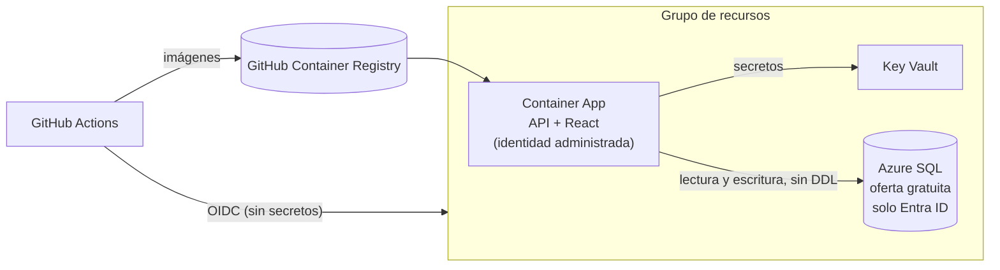

# Despliegue en Azure

La demo corre en planes gratuitos de Azure ([ADR 0020](adr/0020-despliegue-en-azure-planes-gratuitos.md)). Se despliega sola después de cada CI exitoso en `main`.



## Qué hace el workflow `Deploy`

1. **Construye y publica las imágenes** (`app` y `migrator`) en GitHub Container Registry, etiquetadas con el commit.
2. **Primera pasada de Bicep:** todo menos la app (identidad, Key Vault, SQL, logs, presupuesto).
3. **Crea los secretos en Key Vault, solo si faltan:** la clave de firma JWT y la contraseña inicial del administrador de la plataforma. Nunca se imprimen.
4. **Abre el firewall de SQL a la IP del runner,** aplica las migraciones como administrador de Entra y crea el usuario de la app con solo lectura y escritura (`infra/sql/grant-app-user.sql`). Después cierra el firewall, aunque algo haya fallado.
5. **Segunda pasada de Bicep:** la app con la imagen nueva.
6. **Prueba de humo:** `/health` y `/login`. El primer arranque puede tardar si la base estaba pausada.

## Configuración inicial (una sola vez)

Necesita una suscripción de Azure (la [cuenta gratuita](https://azure.microsoft.com/free/) sirve), [Azure CLI](https://learn.microsoft.com/cli/azure/install-azure-cli) y `gh` con sesión iniciada.

```powershell
az login
./infra/setup-azure.ps1 -BootstrapAdminEmail <email del administrador> -BudgetEmail <su correo>
```

El script es idempotente y crea:

- el grupo de recursos;
- la aplicación de Entra que usa GitHub, con una credencial federada para `main` y sin secreto;
- sus roles, limitados al grupo de recursos;
- el grupo de Entra que administra SQL (usted y el workflow);
- las variables del repositorio.

Después:

1. **Ejecute el workflow** `Deploy` desde la pestaña Actions, o haga un push a `main`.
2. **Las imágenes quedan públicas solas:** GitHub hereda la visibilidad del repositorio público al crear los paquetes (`farmacia-saas` y `farmacia-saas-migrator`). La Container App las descarga sin credenciales. Si el repositorio fuera privado, habría que hacerlas públicas a mano (*Package settings* → *Change visibility*) o darle credenciales del registro a la app.
3. **Entre como administrador de la plataforma.** La contraseña inicial está en Key Vault, que por mínimo privilegio solo leen la app y el workflow. Dese permiso de lectura una vez y léala:

   ```powershell
   $vault = az keyvault list -g rg-farmacia-demo --query "[0].name" -o tsv
   az role assignment create --role "Key Vault Secrets User" --assignee (az ad signed-in-user show --query id -o tsv) --scope (az keyvault show --name $vault --query id -o tsv)
   # El rol tarda uno o dos minutos en aplicarse
   az keyvault secret show --vault-name $vault --name bootstrap-admin-password --query value -o tsv
   ```

   La app le pedirá cambiarla al entrar. Después cree la primera farmacia.

## Costos

Todo está dentro de los planes gratuitos, con dos condiciones:

- La base se pausa si se acaba su cupo del mes.
- Una pestaña abierta mantiene la app despierta y consume el cupo de Container Apps.

El presupuesto de USD 5 al mes avisa por correo antes de que cueste algo. Para que la farmacia lo use de verdad, vea las consecuencias del ADR 0020: es un cambio de plan, no de código.

## Si algo falla

- **"Location '…' is not accepting creation of new Windows Azure SQL Database servers":** las cuentas de prueba tienen regiones restringidas para SQL. En la primera instalación, East US, East US 2, West US 2, North Central US y South Central US estaban restringidas; Central US, West US 3, Canada Central y Brazil South no. Revise la región con:

  ```powershell
  az rest --method get --url "https://management.azure.com/subscriptions/<id>/providers/Microsoft.Sql/locations/<región>/capabilities?api-version=2021-11-01" --query "{estado:status, razon:reason}"
  ```

  `Available` significa que acepta servidores nuevos. Cambie la variable `AZURE_LOCATION` del repositorio. Los nombres incluyen la región (en su sufijo), así que en la región nueva todo se crea con nombres nuevos. Borre después los recursos que quedaron en la región anterior.
- **"The subscription is not registered to use namespace …":** el registro de proveedores tarda unos minutos después del script. Vuelva a ejecutar el workflow.
- **"could not create jwt-signing-key" en el paso de los secretos:** el rol *Key Vault Secrets Officer* del workflow, asignado en ese mismo despliegue, todavía no se aplicaba (puede tardar varios minutos). El paso reintenta unos 6 minutos y muestra el error de Azure; si aun así falla, vuelva a ejecutar el workflow.
- **La app no arranca y los logs dicen `Login failed for user '<token-identified principal>'`:** falta el usuario de la app en la base. El paso "The app's database user" del workflow debe haber terminado bien.
- **El primer request tarda casi un minuto:** la base de la oferta gratuita estaba pausada y se está reanudando. Es normal en la demo.
- **Ver los logs:** `az containerapp logs show -g rg-farmacia-demo -n ca-farmacia --follow`.
