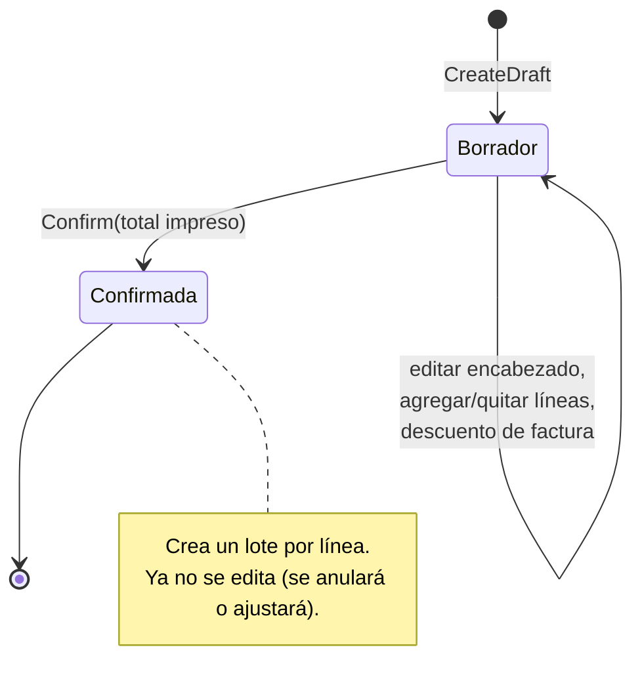
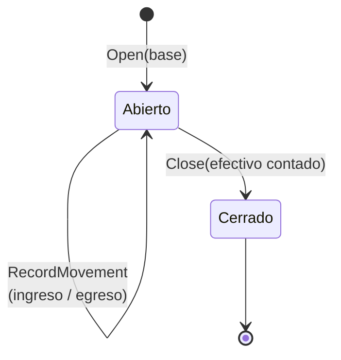

# Dominio: cómo funciona el negocio

Este documento explica las reglas de la farmacia tal como están en el código (`src/Farmacia.Domain`). Si una regla cambia, cambia aquí y en sus tests.

## Glosario

| Término | Significado | En el código |
|---|---|---|
| Farmacia / droguería | El cliente del SaaS (tenant) | `Pharmacy` |
| NIT | Identificación tributaria colombiana con dígito de verificación (DV) | `Nit` (value object) |
| Presentación | Cómo se vende un producto: caja x30, blíster x10, tableta | `SaleUnit` |
| Unidad base | La unidad más pequeña en que se cuenta el stock (p. ej. tableta) | `Product.BaseUnitName` |
| Factor de conversión | Cuántas unidades base trae una presentación (caja x30 = 30) | `SaleUnit.ConversionFactor` |
| Lote | Mercancía con un mismo número de lote, vencimiento y costo | `Batch` |
| Kardex | Historial de cada entrada y salida de un lote | `StockMovement` |
| FEFO | *First Expired, First Out*: se vende primero lo que vence primero | `FefoAllocator` |
| Bonificación | Unidades que el proveedor regala en la factura | `PurchaseItem.BonusQuantity` |
| Turno | El período de un cajero en la caja, de la apertura al cierre | `CashSession` |
| Base | El efectivo con que empieza un turno (para dar vueltas) | `CashSession.OpeningFloat` |
| Venta / tiquete | Una venta completa, con sus líneas y pagos | `Sale`, `SaleItem`, `Payment` |
| Devuelta | El cambio que se le da al cliente cuando paga en efectivo | `Payment.Change` |

## Productos y venta fraccionada

Un producto (p. ej. "Acetaminofén 500 mg") tiene una unidad base ("Tableta") y una o varias presentaciones, cada una con su factor de conversión, su precio y, opcionalmente, su código de barras:

| Presentación | Factor | Precio |
|---|---|---|
| Caja x30 | 30 | $12.000 |
| Blíster x10 | 10 | $4.500 |
| Tableta | 1 | $500 |

**El stock siempre se guarda en unidades base.** Vender una caja descuenta 30 tabletas; vender un blíster, 10. Así se puede vender fraccionado sin manejar "media caja".

**Mantener el catálogo** (ver [ADR 0011](adr/0011-catalogo-desactivar-y-precio-actual.md)):
- `UpdateDetails` corrige los datos del producto (nombre, unidad base, principio activo, fórmula, registro sanitario, categoría, IVA).
- `UpdateSaleUnit` cambia una presentación: nombre, factor, precio y código de barras. El nombre y el código siguen siendo únicos dentro del producto (sin compararse consigo misma), y entre productos los protege el índice único de la base. Un precio nuevo aplica solo a las ventas siguientes, porque cada venta copió el suyo; un factor nuevo no altera el stock, porque está en unidades base.
- `Deactivate`/`Activate`: un producto descontinuado se desactiva, nunca se borra, porque lotes y ventas lo referencian. Inactivo, la venta lo rechaza.

**Casos de uso y endpoints del catálogo:** las búsquedas (`GET /api/products?search=`) devuelven solo productos activos, así el POS y las compras nunca ofrecen un descontinuado; `includeInactive=true` los incluye. `AddPurchaseItem` rechaza un producto inactivo. Un código de barras que ya usa otro producto es 409 (con un mensaje claro antes del índice único); una presentación puede conservar el suyo.

| Endpoint | Política | Qué hace |
|---|---|---|
| `GET /api/products?search=&includeInactive=` | Autenticado | Búsqueda (POS, compras) |
| `GET /api/products/catalog?search=&includeInactive=` | `ManageCatalog` | Catálogo con stock: unidades vendibles, vencidas y el vencimiento más próximo, con la fecha de Colombia |
| `GET /api/products/{id}/batches` | `ManageCatalog` | Lotes con unidades, el que vence primero arriba, con su costo (el cajero no ve costos) |
| `PUT /api/products/{id}` | `ManageCatalog` | Corrige los datos del producto |
| `POST /api/products/{id}/sale-units` | `ManageCatalog` | Agrega una presentación (201) |
| `PUT /api/products/{id}/sale-units/{saleUnitId}` | `ManageCatalog` | Cambia nombre, factor, precio o código |
| `POST /api/products/{id}/deactivate` y `/activate` | `ManageCatalog` | Descontinúa o reactiva |
| `GET /api/categories`, `POST /api/categories` | Autenticado / `ManageCatalog` | Categorías (el nombre es único sin distinguir mayúsculas) |

## Inventario: lotes y kardex

- **Cada entrada de mercancía crea un `Batch`** con su número de lote, vencimiento, cantidad y costo por unidad base.
- **Cada cambio de cantidad genera un `StockMovement`** (compra, venta, ajuste por conteo, baja por vencimiento) con el cambio y el saldo resultante. `Batch` deja los movimientos en `PendingMovements`, y `FarmaciaDbContext` los guarda en el **mismo `SaveChanges`** que el lote: el kardex nunca queda desfasado del stock.
- **Un lote se vende hasta su fecha de vencimiento inclusive.** Desde el día siguiente está vencido: no se vende, solo se da de baja (`WriteOffExpired`).
- **El stock nunca queda negativo en línea:** vender más de lo disponible lanza `DomainException`.
- **Cada movimiento dice quién lo causó** (`PerformedBy`): las operaciones de `Batch` (`Receive`, `Sell`, `Restock`, `WriteOffExpired`, `AdjustToCount`) reciben el usuario, y la compra, la venta y la devolución pasan el suyo. Ver [ADR 0012](adr/0012-inventario-bajas-y-ajustes-por-lote.md).
- **`FefoAllocator` solo planifica.** Recibe los lotes de un producto y la cantidad, y devuelve de qué lotes sacarla, empezando por el que vence primero. Quien vende aplica `Batch.Sell` a cada uno.

## Compras



- **La factura se digita como borrador, y cada acción se guarda de inmediato.** Un corte de luz no hace perder lo digitado, y el inventario no cambia hasta confirmar.
- **Toda línea trae lote y vencimiento.** Una misma factura no puede tener dos líneas del mismo producto con el mismo lote.
- **La factura es única por proveedor y número.**
- **Al confirmar se digita el total impreso en la factura.** Si difiere del calculado en más de $1, no se confirma: así se detectan errores de digitación. Por eso la pantalla **no muestra** el total calculado al confirmar: el usuario lo copiaría y la verificación no serviría.
- **El costo real por unidad base** de cada lote es:

  ```
  (cantidad × costo − descuento de línea − parte del descuento de factura [+ IVA si es costo])
  ────────────────────────────────────────────────────────────────────────────────────────────
                        (cantidad + bonificación) × factor de conversión
  ```

  Ejemplo: 10 cajas x30 a $9.000, con 2 cajas de bonificación y $3.000 de descuento, dan $87.000 para 360 tabletas, es decir, $241,6667 por tableta.
- **El descuento de factura se reparte** entre las líneas en proporción a su valor neto (la última recibe el residuo del redondeo) y **reduce la base del IVA**.
- **El IVA (0 %, 5 % o 19 %) va por línea.** Si la farmacia es responsable de IVA (`Pharmacy.IsVatResponsible`, por defecto sí), el IVA de las compras es descontable y **no** se suma al costo. Esto está pendiente de confirmar con el contador.
- **Confirmar es atómico.** Primero se valida todo y después se cambia el estado. La compra, los lotes y el kardex se guardan en una sola transacción, y un doble clic no recibe la mercancía dos veces (`RowVersion`).

## Caja



- **Una caja, varios turnos al día, y solo un turno abierto a la vez.** Lo garantiza un índice único filtrado en la base de datos.
- **Solo quien abrió el turno registra movimientos en él** (y venderá en él), ni siquiera el dueño. Si alguien cubre al cajero, se cierra ese turno y se abre otro. Así un faltante siempre tiene responsable.
- **Cierra el turno quien lo abrió, o el dueño** si quedó olvidado. `ClosedBy` registra quién lo cerró.
- **Los movimientos son el efectivo que entra o sale sin ser una venta:** domicilios, retiros del dueño, sencillo del banco. El monto siempre es positivo y el tipo da el signo.
- **Cálculo del cierre:**

  ```
  esperado   = base + ingresos − egresos + efectivo neto de ventas (recibido − devuelta − reintegros)
  diferencia = contado − esperado        (positiva: sobrante; negativa: faltante)
  ```

  Ejemplo: base de $100.000, un egreso de $8.000 y ventas en efectivo por $350.000 dan $442.000 esperados. Si se cuentan $440.000, hay un faltante de $2.000.
- **Conteo a ciegas:** mientras el turno está abierto, el cajero **no ve** el esperado; la API no se lo envía. Si lo viera, tendería a "contar" hasta que le diera, y un faltante real quedaría oculto. El dueño sí lo ve en todo momento.
- **Al cerrar se guardan el esperado y el contado.** El cierre es un documento histórico: si después se corrige una venta, el cierre que hizo el cajero no cambia solo.
- **El turno no suma las ventas una por una**, porque todas pelearían por la misma fila. Al cerrar, el caso de uso calcula el efectivo neto de las ventas del turno (`ICashSalesReader`): el efectivo aplicado de las ventas del turno menos los reintegros de las devoluciones hechas en él (de ventas de cualquier turno, porque el dinero sale de este cajón).
- **Al abrir se sugiere como base lo que se contó en el último cierre.**

## Ventas

**El carrito vive en el navegador.** "Cobrar" envía la venta completa y `Sale.Register` la registra en un solo paso:

1. **Precio desde el catálogo.** El navegador solo envía el producto, la presentación y la cantidad. La línea (`SaleItem`) copia el precio, la tarifa de IVA y el factor de conversión, para que el tiquete no cambie si mañana cambia el catálogo.
2. **Stock por FEFO.** Antes de tocar nada, se verifica que alcance el stock de **cada producto sumando todas sus líneas** (una caja x30 más 5 tabletas piden 35 tabletas de los mismos lotes). Después se descuenta lote por lote, y cada línea guarda de qué lotes salió y a qué costo (`SaleItemBatch`). Eso da el margen real de la venta. Los lotes vencidos se saltan.
3. **Fórmula médica.** Si algún producto la requiere, el cajero debe marcar "Fórmula revisada" (una casilla por venta). Se guarda quién la marcó y cuándo, y cada línea recuerda si requería fórmula.
4. **Pagos.** Los medios son efectivo, tarjeta, billetera (Nequi o Daviplata) y transferencia; el fiado llegará después.
   - Tarjeta, billetera y transferencia pagan su monto exacto y no pueden superar el total.
   - El efectivo cubre el resto: el cajero digita lo que entregó el cliente y el sistema calcula la devuelta.
   - El pago en efectivo guarda el monto **aplicado** a la venta y lo **recibido**. Así, el efectivo de un turno es la suma de los pagos en efectivo.

   Ejemplo: un total de $36.000, pagado con $20.000 en tarjeta y $20.000 en efectivo, aplica $16.000 de efectivo y da $4.000 de devuelta.
5. **Si algo falla** (stock, fórmula o pagos), no se toca ningún lote.

**Los precios incluyen el IVA**, y el IVA se desglosa: un producto al 19 % de $11.900 contiene $1.900 de IVA (11.900 × 19/119). Cada producto tiene su tarifa (`Product.VatRate`, 0 % por defecto, que es lo normal en los medicamentos). No hay descuentos en el mostrador.

**El caso de uso `RegisterSale`:**
- exige que el turno abierto sea de quien vende;
- reserva el número del tiquete;
- guarda en **una sola transacción** la venta, el stock de los lotes y el kardex.

Si dos ventas toman a la vez las últimas unidades del mismo lote (por ejemplo, un doble clic en "Cobrar"), la segunda recibe un 409 por el `RowVersion` del lote; si empieza cuando la primera ya terminó, recibe un 400 por falta de stock. Nunca se vende dos veces la misma unidad: un test de API lo prueba, y sin `RowVersion` ese test falla. El efectivo de las ventas ya cuenta en el cierre de caja.

**Endpoints** (`/api/sales`, política `OperateCash`): `POST` cobra y responde 201 con el **tiquete completo**, no solo el id como las demás creaciones, porque el POS lo imprime enseguida; `GET {id}` devuelve un tiquete para reimprimirlo; `GET ?cashSessionId=` lista las ventas de un turno, de la más reciente a la más antigua. El tiquete no trae costos.

## Devoluciones

Ver [ADR 0009](adr/0009-devoluciones-como-documento-aparte.md).

**`SaleReturn` es un agregado aparte, con su propio consecutivo.** La venta nunca se modifica; lo que queda por devolver de cada línea es lo vendido menos las devoluciones anteriores del mismo tiquete.

`SaleReturn.Register` recibe el tiquete, sus devoluciones anteriores, el turno de quien devuelve, el motivo (obligatorio) y las líneas a devolver (`ReturnLine`: línea del tiquete, cantidad en la presentación vendida y destino):
- **`Restock` (vuelve al inventario):** `Batch.Restock` reingresa las unidades al lote del que salieron, con un movimiento `CustomerReturn` en el kardex. Si la línea salió de varios lotes, se llena primero el que vence más tarde (el inverso de FEFO): devolver todo deja los lotes como antes de la venta. Un lote vencido no recibe unidades; hay que descartarlas.
- **`Discard` (se descarta):** abierto, dañado o fuera de la cadena de frío. No toca el stock.
- **El reintegro (`Refund`) es lo pagado por esas unidades**, IVA incluido, siempre en efectivo y desde el turno de quien hace la devolución.
- Como en la venta, **primero se valida todo y después se reingresa**: una línea inválida deja todos los lotes intactos.

**El caso de uso `RegisterSaleReturn`:**
- exige que el turno abierto sea de quien devuelve (403 si es de otro cajero, 409 si no hay turno);
- dentro de una transacción, **reserva el número de la devolución antes de leer las devoluciones anteriores del tiquete**. El bloqueo del contador pone en fila las devoluciones simultáneas: la segunda ve la primera y no puede devolver otra vez lo mismo;
- guarda la devolución, los lotes y el kardex en un solo `SaveChanges`.

El tiquete (`SaleDto`) trae por línea `ReturnedQuantity` (lo ya devuelto), y se puede buscar por su número impreso (`GetSaleByNumber`), que es como empieza una devolución en el mostrador.

**Endpoints** (política `OperateCash`): `GET /api/sales/by-number/{number}` busca el tiquete (una ruta propia, porque `GET /api/sales?cashSessionId=` devuelve una lista y este un solo tiquete o 404); `POST /api/sale-returns` devuelve y responde 201 con el **comprobante completo**, igual que la venta con su tiquete; `GET /api/sale-returns/{id}` lo devuelve para reimprimirlo. El destino de cada línea viaja como texto (`"Restock"` o `"Discard"`).

## Fiado

Ver [ADR 0010](adr/0010-fiado-con-cuenta-cupo-y-abonos.md).

**`CreditAccount` es la cuenta de fiado de un cliente de confianza**, como el cuaderno del mostrador. El dueño la abre con un **cupo**. Guarda el **saldo** y cada cambio queda en un `CreditEntry` (fiado, abono o devolución) con el saldo resultante: el mismo patrón del lote y su kardex.
- **`Charge`:** la parte de una venta que se fía. No puede pasarse del cupo; el mensaje dice cuánto hay disponible. Una cuenta suspendida (`Suspend`) no recibe fiados.
- **`ReceivePayment`:** un abono, que no puede superar la deuda (no hay saldo a favor). Una cuenta suspendida sí recibe abonos.
- **`CreditReturn`:** una devolución de algo fiado baja la deuda en vez de entregar efectivo.
- **`ChangeLimit`:** se puede bajar el cupo por debajo de la deuda; solo frena los fiados nuevos.
- **`DebtSince`:** desde cuándo el cliente debe sin interrupción. Empieza con la primera deuda y se borra cuando paga todo.

**`CreditPayment` es el abono**, con su propio consecutivo y comprobante: va al saldo del cliente, no a un tiquete; se paga en efectivo, tarjeta, billetera o transferencia (nunca fiado), y lo recibe el cajero en su turno.

**El fiado en la venta (`PaymentMethod.Credit`):** `Sale.Register` recibe la cuenta del cliente y guarda su `CustomerId`. Como la tarjeta, el fiado paga un monto exacto, en un solo pago y sin superar el total. **El cupo se verifica con los pagos, antes de tocar el stock** (`EnsureCanCharge`), y la deuda sube solo al final (`Charge`): si algo falla, ni los lotes ni la cuenta cambian. Sin la cuenta, un pago "fiado" se rechaza (sería una venta gratis).

**El fiado en la devolución:** lo que se fió no se devuelve en efectivo. `SaleReturn.Register` descuenta de la deuda lo **menor** entre el reintegro, lo fiado en ese tiquete que aún no se ha descontado (otras devoluciones del mismo tiquete pudieron descontar ya) y la deuda actual. El resto es efectivo. Si el cliente ya había pagado la deuda con abonos, recibe efectivo, porque esa plata sí la puso. La devolución guarda `CreditedToAccount` y `CashRefund`, y **la caja resta solo el `CashRefund`**.

**Los casos de uso:**
- `RegisterSale` recibe opcionalmente el `CustomerId` y carga la cuenta del cliente. Si el cliente no tiene fiado habilitado, la venta fiada se rechaza (400).
- `RegisterSaleReturn` carga la cuenta cuando el tiquete tuvo fiado, después de reservar el número (igual que las devoluciones anteriores).
- `RegisterCreditPayment` (abono): exige el turno propio, reserva el número del abono, lee la cuenta y guarda el abono, la cuenta y su movimiento en una transacción. `GetCreditPaymentById` devuelve el comprobante.
- **Concurrencia del cupo:** si dos cajas le fían a la vez al mismo cliente, el `RowVersion` de la cuenta hace que la segunda reciba un 409. Un test de integración lo prueba con dos ventas que salen de lotes distintos (si salieran del mismo lote, el `RowVersion` del lote taparía el de la cuenta); sin el `RowVersion` de la cuenta, el test falla.
- **Caja:** el efectivo esperado suma los abonos en efectivo y resta solo la parte de las devoluciones que salió en efectivo. Un test cierra un turno con venta mixta, abonos en efectivo y por Nequi, y una devolución de algo fiado.

El tiquete (`SaleDto`) trae `CustomerName` y `CreditAmount`; el comprobante de devolución, `CreditedToAccount` y `CashRefund`.

**La administración** (solo el dueño, política `ManageCredit`): `CreateCustomer` (documento repetido = 409), `OpenCreditAccount` (una cuenta por cliente; la segunda = 409), `ChangeCreditLimit`, `SetCreditSuspended`, `ListDebtors` (quien debe, la deuda más vieja primero, con los días que lleva). El cajero (`OperateCash`) busca clientes (`SearchCustomers`, con su cupo disponible) y ve el estado de cuenta (`GetCreditStatement`: saldo y movimientos, el más reciente primero). Los días de deuda se cuentan con la fecha de Colombia (`IClock`), no la del servidor.

**Endpoints:**

| Endpoint | Política | Qué hace |
|---|---|---|
| `GET /api/customers?search=` | `OperateCash` | Busca por nombre o documento, con el fiado de cada uno |
| `GET /api/customers/{id}` | `OperateCash` | Un cliente con su fiado |
| `POST /api/customers` | `ManageCredit` | Registra un cliente (201) |
| `GET /api/customers/{id}/credit` | `OperateCash` | Estado de cuenta |
| `POST /api/customers/{id}/credit` | `ManageCredit` | Habilita el fiado con un cupo (201) |
| `PUT /api/customers/{id}/credit/limit` | `ManageCredit` | Cambia el cupo (204) |
| `POST /api/customers/{id}/credit/suspend` y `/resume` | `ManageCredit` | Suspende o reanuda (204) |
| `GET /api/customers/debtors` | `ManageCredit` | Quién debe |
| `POST /api/credit-payments` | `OperateCash` | Abono en el turno propio; 201 con el comprobante completo |
| `GET /api/credit-payments/{id}` | `OperateCash` | Reimprime el comprobante |

`POST /api/sales` recibe `customerId` para fiar.

**Pendiente en próximos pasos:** las pantallas (5e).

## Colombia en el código

- **NIT obligatorio** en la farmacia y en los proveedores, con el formato `900123456-8` y el dígito de verificación validado (módulo 11 de la DIAN). El frontend calcula el DV en vivo con el mismo algoritmo y los mismos casos de prueba (`web/src/lib/nit.ts`).
- **Tipos de documento del cliente** con los códigos DIAN como valores del enum, pensando en la facturación electrónica.
- **Hora de Colombia (UTC-5) en todo el sistema.** El dominio nunca usa `DateTime.Now`: recibe las horas desde `IClock`. Esto importa: un timestamp en UTC a las 8 p. m. ya sería el día siguiente y podría vencer un lote un día antes.
- **Dinero en pesos:** se redondea siempre alejándose de cero, como se redondea a mano, y se formatea como "$87.000".
