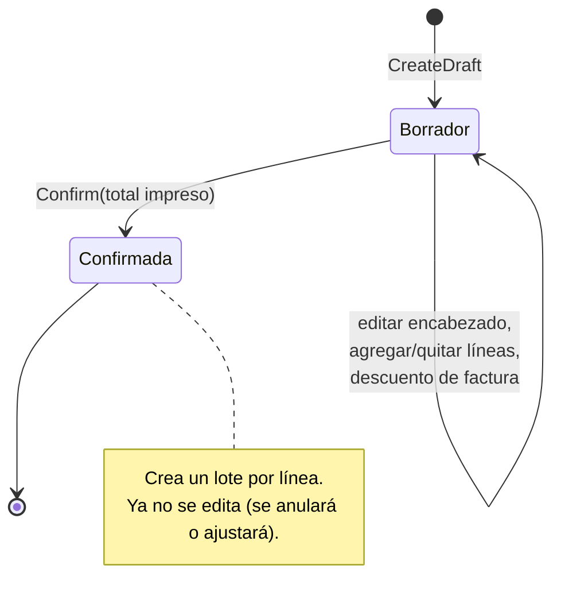
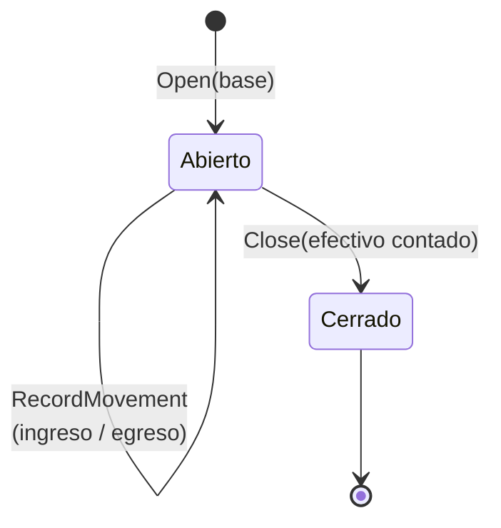

# Dominio: cómo funciona el negocio

Este documento explica las reglas de la farmacia tal como están en el código (`src/Farmacia.Domain`). Si una regla cambia, cambia aquí y en sus tests.

## Glosario

| Término | Significado | En el código |
|---|---|---|
| Farmacia / droguería | El cliente del SaaS (tenant) | `Pharmacy` |
| NIT | Identificación tributaria colombiana con dígito de verificación (DV) | `Nit` (value object) |
| Presentación | Cómo se vende un producto: caja x30, blíster x10, tableta | `SaleUnit` |
| Unidad base | La unidad más pequeña en que se cuenta el stock (p. ej. tableta) | `Product.BaseUnitName` |
| Factor de conversión | Cuántas unidades base trae una presentación (caja x30 = 30) | `SaleUnit.ConversionFactor` |
| Lote | Mercancía con un mismo número de lote, vencimiento y costo | `Batch` |
| Kardex | Historial de cada entrada y salida de un lote | `StockMovement` |
| FEFO | *First Expired, First Out*: se vende primero lo que vence primero | `FefoAllocator` |
| Bonificación | Unidades que el proveedor regala en la factura | `PurchaseItem.BonusQuantity` |
| Turno | El período de un cajero en la caja, de la apertura al cierre | `CashSession` |
| Base | El efectivo con que empieza un turno (para dar vueltas) | `CashSession.OpeningFloat` |

## Productos y venta fraccionada

Un producto (p. ej. "Acetaminofén 500 mg") tiene una unidad base ("Tableta") y una o varias presentaciones, cada una con su factor de conversión, su precio y, opcionalmente, su código de barras:

| Presentación | Factor | Precio |
|---|---|---|
| Caja x30 | 30 | $12.000 |
| Blíster x10 | 10 | $4.500 |
| Tableta | 1 | $500 |

**El stock siempre se guarda en unidades base.** Vender una caja descuenta 30 tabletas; vender un blíster, 10. Así se puede vender fraccionado sin manejar "media caja".

## Inventario: lotes y kardex

- **Cada entrada de mercancía crea un `Batch`** con su número de lote, vencimiento, cantidad y costo por unidad base.
- **Cada cambio de cantidad genera un `StockMovement`** (compra, venta, ajuste por conteo, baja por vencimiento) con el cambio y el saldo resultante. `Batch` deja los movimientos en `PendingMovements`, y `FarmaciaDbContext` los guarda en el **mismo `SaveChanges`** que el lote: el kardex nunca queda desfasado del stock.
- **Un lote se vende hasta su fecha de vencimiento inclusive.** Desde el día siguiente está vencido: no se vende, solo se da de baja (`WriteOffExpired`).
- **El stock nunca queda negativo en línea:** vender más de lo disponible lanza `DomainException`.
- **`FefoAllocator` solo planifica.** Recibe los lotes de un producto y la cantidad, y devuelve de qué lotes sacarla, empezando por el que vence primero. Quien vende aplica `Batch.Sell` a cada uno.

## Compras



- **La factura se digita como borrador, y cada acción se guarda de inmediato.** Un corte de luz no hace perder lo digitado, y el inventario no cambia hasta confirmar.
- **Toda línea trae lote y vencimiento.** Una misma factura no puede tener dos líneas del mismo producto con el mismo lote.
- **La factura es única por proveedor y número.**
- **Al confirmar se digita el total impreso en la factura.** Si difiere del calculado en más de $1, no se confirma: así se detectan errores de digitación. Por eso la pantalla **no muestra** el total calculado al confirmar: el usuario lo copiaría y la verificación no serviría.
- **El costo real por unidad base** de cada lote es:

  ```
  (cantidad × costo − descuento de línea − parte del descuento de factura [+ IVA si es costo])
  ────────────────────────────────────────────────────────────────────────────────────────────
                        (cantidad + bonificación) × factor de conversión
  ```

  Ejemplo: 10 cajas x30 a $9.000, con 2 cajas de bonificación y $3.000 de descuento, dan $87.000 para 360 tabletas, es decir, $241,6667 por tableta.
- **El descuento de factura se reparte** entre las líneas en proporción a su valor neto (la última recibe el residuo del redondeo) y **reduce la base del IVA**.
- **El IVA (0 %, 5 % o 19 %) va por línea.** Si la farmacia es responsable de IVA (`Pharmacy.IsVatResponsible`, por defecto sí), el IVA de las compras es descontable y **no** se suma al costo. Esto está pendiente de confirmar con el contador.
- **Confirmar es atómico.** Primero se valida todo y después se cambia el estado. La compra, los lotes y el kardex se guardan en una sola transacción, y un doble clic no recibe la mercancía dos veces (`RowVersion`).

## Caja



- **Una caja, varios turnos al día, y solo un turno abierto a la vez.** Lo garantiza un índice único filtrado en la base de datos.
- **Solo quien abrió el turno registra movimientos en él** (y venderá en él), ni siquiera el dueño. Si alguien cubre al cajero, se cierra ese turno y se abre otro. Así un faltante siempre tiene responsable.
- **Cierra el turno quien lo abrió, o el dueño** si quedó olvidado. `ClosedBy` registra quién lo cerró.
- **Los movimientos son el efectivo que entra o sale sin ser una venta:** domicilios, retiros del dueño, sencillo del banco. El monto siempre es positivo y el tipo da el signo.
- **Cálculo del cierre:**

  ```
  esperado   = base + ingresos − egresos + efectivo neto de ventas (recibido − devuelta − reintegros)
  diferencia = contado − esperado        (positiva: sobrante; negativa: faltante)
  ```

  Ejemplo: base de $100.000, un egreso de $8.000 y ventas en efectivo por $350.000 dan $442.000 esperados. Si se cuentan $440.000, hay un faltante de $2.000.
- **Conteo a ciegas:** mientras el turno está abierto, el cajero **no ve** el esperado; la API no se lo envía. Si lo viera, tendería a "contar" hasta que le diera, y un faltante real quedaría oculto. El dueño sí lo ve en todo momento.
- **Al cerrar se guardan el esperado y el contado.** El cierre es un documento histórico: si después se corrige una venta, el cierre que hizo el cajero no cambia solo.
- **El turno no suma las ventas una por una**, porque todas pelearían por la misma fila. Al cerrar, el caso de uso calcula el efectivo neto de las ventas del turno (`ICashSalesReader`). Mientras no existan las ventas, ese valor es $0.
- **Al abrir se sugiere como base lo que se contó en el último cierre.**

## Ventas (próximo paso)

Esto ya está acordado con la farmacia y todavía no está implementado:

- **Medios de pago:** efectivo, tarjeta, Nequi/Daviplata, transferencia y fiado. El **pago mixto** es frecuente, así que una venta tiene varios pagos. En efectivo se registra lo recibido y se calcula la devuelta.
- **No hay descuentos en el mostrador.**
- **Los precios incluyen el IVA.** El IVA se desglosa del precio (19 %: precio × 19/119). El producto tendrá su tarifa de IVA, 0 % por defecto.
- **Fórmula médica:** en los productos que la requieren, el POS exigirá marcar "Fórmula revisada" y guardará quién y cuándo lo hizo.
- **Devoluciones con reintegro de dinero:** el producto vuelve al mismo lote.
- **Fiado** a clientes de confianza, con cuentas por cobrar y abonos.
- **Al cliente se le entrega un tiquete simple** con consecutivo por farmacia. La factura electrónica DIAN queda para después.

## Colombia en el código

- **NIT obligatorio** en la farmacia y en los proveedores, con el formato `900123456-8` y el dígito de verificación validado (módulo 11 de la DIAN). El frontend calcula el DV en vivo con el mismo algoritmo y los mismos casos de prueba (`web/src/lib/nit.ts`).
- **Tipos de documento del cliente** con los códigos DIAN como valores del enum, pensando en la facturación electrónica.
- **Hora de Colombia (UTC-5) en todo el sistema.** El dominio nunca usa `DateTime.Now`: recibe las horas desde `IClock`. Esto importa: un timestamp en UTC a las 8 p. m. ya sería el día siguiente y podría vencer un lote un día antes.
- **Dinero en pesos:** se redondea siempre alejándose de cero, como se redondea a mano, y se formatea como "$87.000".
