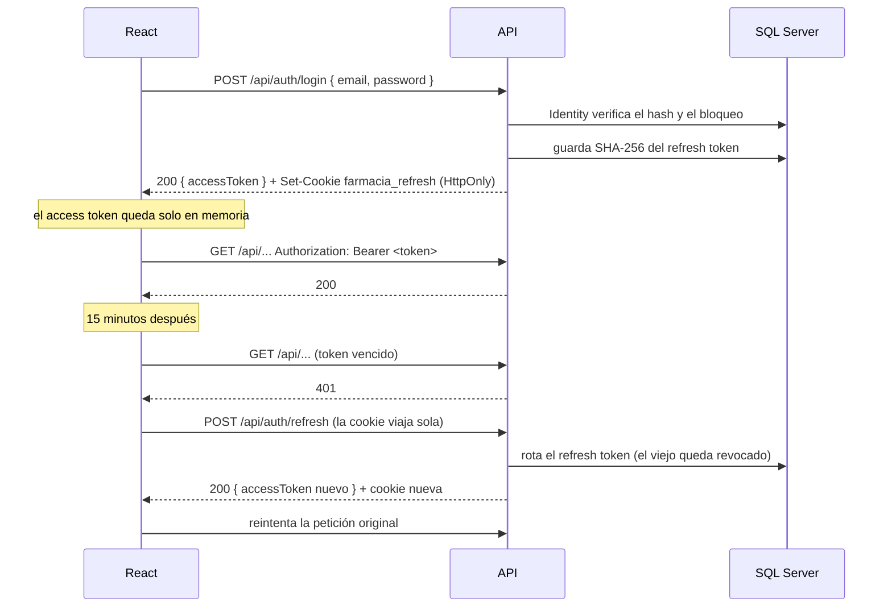

# Seguridad: autenticación, roles y aislamiento

## Resumen

| Pieza | Decisión |
|---|---|
| Usuarios y contraseñas | ASP.NET Core Identity (solo el núcleo: usuarios, roles, hash y bloqueo) |
| Sesión | JWT propio de 15 minutos + refresh token de 7 días en una cookie HttpOnly |
| Permisos | Políticas con nombre (`Policies.cs`) sobre tres roles |
| Aislamiento entre farmacias | El `PharmacyId` sale del JWT firmado; todo repositorio filtra por él |
| Registro | No hay registro público: el dueño crea los usuarios |

## Login y sesión

### Access token (JWT)

- **Lo firma la propia API** con HS256 y una clave de al menos 32 bytes, guardada en user-secrets (`Jwt:SigningKey`). Al arrancar se valida que la clave tenga la longitud mínima y que no sea degenerada (por ejemplo, todos los bytes iguales).
- **Dura 15 minutos**, con 30 segundos de tolerancia de reloj, y el algoritmo está fijado: no se acepta un token firmado de otra forma.
- **Claims:** `sub` (id del usuario), `email`, `name`, `pharmacy_id` y `role` (uno por rol).
- **El cliente lo guarda solo en memoria, nunca en `localStorage`.** Así, un script inyectado (XSS) no lo encuentra guardado.

### Refresh token

- **Son 64 bytes aleatorios**, y en la base se guarda solo su **SHA-256**. Si alguien roba la base, no obtiene tokens utilizables.
- **Viaja solo en la cookie `farmacia_refresh`**, con `HttpOnly` (JavaScript no la lee), `Secure`, `SameSite=Strict` y `Path=/api/auth`.
- **Se rota en cada uso:** cada refresh entrega uno nuevo y revoca el anterior.
- **Si alguien reutiliza un token ya rotado, se revoca toda su familia** (todos los tokens nacidos del mismo login). Esa reutilización solo pasa si el token fue robado, así que el ladrón y la víctima quedan desconectados y la víctima vuelve a iniciar sesión.
- **Logout revoca la familia completa.**

### Protecciones del login

- **El mismo mensaje para "email no existe" y "contraseña incorrecta".** Cuando el email no existe, igual se verifica un hash falso, para que el tiempo de respuesta tampoco revele qué emails están registrados.
- **La cuenta se bloquea 15 minutos** tras 5 intentos fallidos.
- **Contraseña:** mínimo 8 caracteres, con mayúscula, minúscula y número, sin exigir símbolo. Es más útil la longitud que la complejidad para alguien que la escribe muchas veces al día.

## Roles y políticas

| Rol | En español | Para qué |
|---|---|---|
| `Owner` | Dueño | Todo |
| `Cashier` | Cajero | Vender y manejar la caja |
| `StockKeeper` | Bodeguero | Recibir compras y manejar el inventario |

Los controllers no nombran roles: usan **políticas con nombre**, definidas en un solo lugar (`src/Farmacia.Api/Authentication/Policies.cs`):

| Política | Roles | Endpoints |
|---|---|---|
| *(fallback)* | Cualquier usuario autenticado | Todo endpoint sin `[AllowAnonymous]` |
| `ManageCatalog` | Dueño, bodeguero | Crear y editar productos y presentaciones, desactivarlos, el catálogo con stock y los lotes con su costo, crear categorías; proveedores |
| `ReceivePurchases` | Dueño, bodeguero | Todo `/api/purchases`, incluida la lectura, porque muestra costos |
| `OperateCash` | Dueño, cajero | Todo `/api/cash-sessions`, `/api/sales`, `/api/sale-returns` y `/api/credit-payments`; buscar clientes y ver su estado de cuenta en `/api/customers` |
| `ManageInventory` | Dueño, bodeguero | Dar de baja lotes vencidos (`POST /api/batches/{id}/write-off`), ajustar por conteo (`POST /api/batches/{id}/adjust`) y el kardex (`GET /api/products/{id}/kardex`) |
| `ManageCredit` | Dueño | Crear clientes, abrir la cuenta de fiado, cambiar el cupo, suspender y reanudar, lista de deudores. Se exige además de `OperateCash` (las dos políticas a la vez) |

- **La fallback policy exige estar autenticado en todo endpoint.** Un controller que olvide `[Authorize]` queda protegido, no expuesto. Los únicos anónimos son `/health`, `login`, `refresh` y `logout` (y la documentación OpenAPI en Development). `SecurityConventionTests` falla si se quita la fallback policy o si aparece un endpoint anónimo nuevo: agregar uno debe ser una decisión consciente.
- **La política dice quién puede usar el recurso; el caso de uso dice qué puede tocar cada uno.** Por ejemplo, `OperateCash` deja entrar a cualquier cajero a la caja, pero solo quien abrió un turno puede registrar movimientos en él. Eso depende de datos y lo decide el handler, que lanza `ForbiddenException` (403).
- **El frontend replica las políticas en `web/src/features/auth/permissions.ts`**, pero solo para ocultar menús y botones. Quien las hace cumplir es la API.

## Aislamiento entre farmacias (tenant)

1. **Cada usuario pertenece a una sola farmacia** (`AspNetUsers.PharmacyId`), y esa farmacia viaja en el claim `pharmacy_id` del JWT firmado. El cliente no puede cambiarla sin invalidar la firma.
2. **`ICurrentPharmacy`, implementado por `HttpContextCurrentPharmacy`, lee la farmacia del token.** El `PharmacyId` **nunca** viene del body ni de la URL.
3. **Todo método de repositorio recibe el `PharmacyId` y filtra por él.** El aislamiento está en la construcción misma, no depende de acordarse.
4. **Un recurso de otra farmacia responde 404, nunca 403.** Responder 403 confirmaría que ese Id existe.

Los tests de la API usan dos farmacias (A y B) para comprobar este aislamiento por HTTP.

## Secretos

| Secreto | Dónde vive en desarrollo | En producción (fase 5) |
|---|---|---|
| Contraseña de SQL Server | `.env` (ignorado por git; la plantilla es `.env.example`) | Azure Key Vault |
| Cadena de conexión | user-secrets del proyecto Api (`ConnectionStrings:Farmacia`) | Key Vault |
| Clave de firma JWT | user-secrets (`Jwt:SigningKey`) | Key Vault |
| Clave de licencia de MediatR | user-secrets (`MediatR:LicenseKey`) | Key Vault |

**Ningún secreto va en el repositorio** ni en `appsettings*.json`. Las contraseñas de los usuarios de desarrollo están en `appsettings.Development.json` porque esos usuarios solo existen en la base local.

## Otras protecciones

- **Redirección tras el login:** `safeRedirectPath` solo acepta rutas internas, para evitar *open redirects* (`//sitio-falso.com`, `javascript:`, etc.).
- **Errores:** un error inesperado responde 500 sin detalles internos. El detalle queda en el log del servidor.
- **Paquetes vulnerables:** `System.Security.Cryptography.Pkcs` está fijado en Infrastructure porque la versión que trae SqlClient tiene vulnerabilidades conocidas. Con `TreatWarningsAsErrors`, un paquete vulnerable rompe la compilación. En el frontend, `npm audit --omit=dev` debe quedar limpio.
