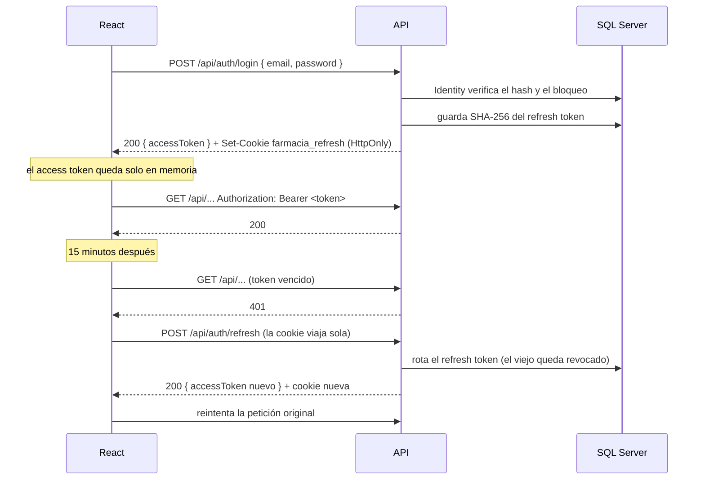
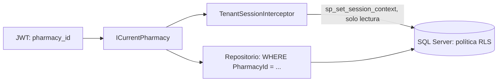

# Seguridad: autenticación, roles y aislamiento

## Resumen

| Pieza | Decisión |
|---|---|
| Usuarios y contraseñas | ASP.NET Core Identity (solo el núcleo: usuarios, roles, hash y bloqueo) |
| Sesión | JWT propio de 15 minutos + refresh token de 7 días en una cookie HttpOnly |
| Permisos | Políticas con nombre (`Policies.cs`) sobre tres roles de farmacia y el administrador de la plataforma |
| Aislamiento entre farmacias | El `PharmacyId` sale del JWT firmado; todo repositorio filtra por él, y Row-Level Security de SQL Server lo hace cumplir en la base |
| Registro | No hay registro público: el administrador de la plataforma crea cada farmacia con su dueño, y el dueño crea los demás usuarios, con una contraseña temporal que deben cambiar al entrar |

## Login y sesión

### Access token (JWT)

- **Lo firma la propia API** con HS256 y una clave de al menos 32 bytes, guardada en user-secrets (`Jwt:SigningKey`). Al arrancar se valida que la clave tenga la longitud mínima y que no sea degenerada (por ejemplo, todos los bytes iguales).
- **Dura 15 minutos**, con 30 segundos de tolerancia de reloj, y el algoritmo está fijado: no se acepta un token firmado de otra forma.
- **Claims:** `sub` (id del usuario), `email`, `name`, `pharmacy_id` y `role` (uno por rol). El administrador de la plataforma no tiene farmacia: su token no lleva `pharmacy_id`. Con una contraseña temporal, el token lleva además `pwd_change` (ver abajo).
- **El cliente lo guarda solo en memoria, nunca en `localStorage`.** Así, un script inyectado (XSS) no lo encuentra guardado.

### Refresh token

- **Son 64 bytes aleatorios**, y en la base se guarda solo su **SHA-256**. Si alguien roba la base, no obtiene tokens utilizables.
- **Viaja solo en la cookie `farmacia_refresh`**, con `HttpOnly` (JavaScript no la lee), `Secure`, `SameSite=Strict` y `Path=/api/auth`.
- **Se rota en cada uso:** cada refresh entrega uno nuevo y revoca el anterior.
- **Si alguien reutiliza un token ya rotado, se revoca toda su familia** (todos los tokens nacidos del mismo login). Esa reutilización solo pasa si el token fue robado, así que el ladrón y la víctima quedan desconectados y la víctima vuelve a iniciar sesión.
- **Logout revoca la familia completa.**

### Protecciones del login

- **El mismo mensaje para "email no existe" y "contraseña incorrecta".** Cuando el email no existe, igual se verifica un hash falso, para que el tiempo de respuesta tampoco revele qué emails están registrados.
- **La cuenta se bloquea 15 minutos** tras 5 intentos fallidos.
- **Contraseña:** mínimo 8 caracteres, con mayúscula, minúscula y número, sin exigir símbolo. Es más útil la longitud que la complejidad para alguien que la escribe muchas veces al día.

### Usuarios: desactivar y contraseñas temporales

Detalle en el [ADR 0016](adr/0016-usuarios-de-la-farmacia.md).

- **Desactivar** (`AspNetUsers.IsActive = false`) revoca todos los refresh tokens del usuario, y el login y el refresh lo rechazan. El access token que ya tiene dura hasta 15 minutos más. Los usuarios nunca se borran, porque ventas, turnos y kardex los referencian.
- **Contraseña temporal:** quien crea un usuario o le restablece la contraseña escribe una temporal. El usuario queda con `MustChangePassword`, y su token lleva el claim `pwd_change`. **Toda política con nombre y la de respaldo exigen que ese claim no esté** (`PasswordChangedRequirement`). Hasta cambiarla, solo puede usar `/api/auth/me`, `POST /api/auth/change-password`, `refresh` y `logout`. Así, el dueño, que conoce la contraseña temporal, no puede trabajar con la cuenta de otro. `SecurityConventionTests` falla si una política no incluye el requisito.
- **Cambiar la contraseña** pide la actual, cierra las demás sesiones del usuario y entrega un token nuevo sin la marca. **Restablecerla** también cierra las sesiones y desbloquea la cuenta.
- **Nunca cero dueños activos,** y nadie se desactiva ni se cambia el rol a sí mismo.

### Tiempo real (SignalR)

- **El hub `/hubs/pharmacy` exige la política `UsePharmacy`:** un usuario de una farmacia, sin contraseña temporal. Cada conexión entra al grupo de **su** farmacia, tomado del token, nunca del cliente. Detalle en el [ADR 0017](adr/0017-tiempo-real-con-avisos-delgados.md).
- **El token en la URL solo vale para el hub.** El navegador no puede enviar cabeceras al abrir un WebSocket, así que SignalR manda `?access_token=`. `OnMessageReceived` lo lee solo si la ruta es la del hub; en la API REST se ignora (test `TheTokenInTheQueryString_IsAcceptedOnlyByTheHub`). Ojo: una URL con token puede quedar en logs de proxies, otra razón para que el access token dure solo 15 minutos.
- **Los avisos no llevan datos:** solo un tema y, a veces, un Id. Una conexión que sobrevive a su token (SignalR autentica solo al conectar) no recibe nada que su usuario no pudiera ver: los datos se piden por REST, con un token vigente.

## Roles y políticas

| Rol | En español | Para qué |
|---|---|---|
| `Owner` | Dueño | Todo |
| `Cashier` | Cajero | Vender y manejar la caja |
| `StockKeeper` | Bodeguero | Recibir compras y manejar el inventario |
| `PlatformAdmin` | Administrador de la plataforma | Crear farmacias con su dueño. No pertenece a ninguna farmacia y no ve sus datos ([ADR 0015](adr/0015-alta-de-farmacias-por-el-administrador.md)) |

Los controllers no nombran roles: usan **políticas con nombre**, definidas en un solo lugar (`src/Farmacia.Api/Authentication/Policies.cs`):

| Política | Roles | Endpoints |
|---|---|---|
| *(fallback)* | Cualquier usuario autenticado **de una farmacia** (exige el claim `pharmacy_id`) | Todo endpoint sin `[AllowAnonymous]` ni política propia. El administrador de la plataforma recibe 403 |
| `ManageCatalog` | Dueño, bodeguero | Crear y editar productos y presentaciones, desactivarlos, el catálogo con stock y los lotes con su costo, crear categorías; proveedores |
| `ReceivePurchases` | Dueño, bodeguero | Todo `/api/purchases`, incluida la lectura, porque muestra costos |
| `OperateCash` | Dueño, cajero | Todo `/api/cash-sessions`, `/api/sales`, `/api/sale-returns` y `/api/credit-payments`; buscar clientes y ver su estado de cuenta en `/api/customers` |
| `ManageInventory` | Dueño, bodeguero | Las alertas de stock (`GET /api/stock-alerts`); dar de baja lotes vencidos (`POST /api/batches/{id}/write-off`), ajustar por conteo (`POST /api/batches/{id}/adjust`) y el kardex (`GET /api/products/{id}/kardex`) |
| `PaySuppliers` | Dueño | Pagar facturas de proveedores a crédito (`POST /api/purchases/{id}/payments`); se exige además de `ReceivePurchases` |
| `ManagePharmacy` | Dueño | Editar los datos de la farmacia (`PUT /api/pharmacy`): nombre, dirección y teléfono del tiquete, y si el IVA de las compras es descontable. La lectura (`GET /api/pharmacy`) es para cualquier usuario de la farmacia, porque el cajero imprime su nombre y NIT. Ninguna de las dos lleva Id: siempre es la farmacia del token |
| `ManageUsers` | Dueño | `/api/users`: listar, crear (con contraseña temporal), cambiar el rol, desactivar y reactivar, restablecer la contraseña. Un usuario de otra farmacia responde 404 |
| `ViewDashboard` | Dueño | El resumen del día (`GET /api/dashboard/today`): muestra costos y margen |
| `UsePharmacy` | Cualquier usuario de una farmacia, sin contraseña temporal (la misma regla que la de respaldo) | El hub de tiempo real `/hubs/pharmacy`, que necesita una política con nombre |
| `ManagePlatform` | Administrador de la plataforma | `/api/platform/pharmacies`: listar las farmacias y crear una con su dueño |
| `ManageCredit` | Dueño | Crear clientes, abrir la cuenta de fiado, cambiar el cupo, suspender y reanudar, lista de deudores. Se exige además de `OperateCash` (las dos políticas a la vez) |

- **La fallback policy exige estar autenticado en todo endpoint.** Un controller que olvide `[Authorize]` queda protegido, no expuesto. Los únicos anónimos son `/health`, `login`, `refresh` y `logout` (y la documentación OpenAPI en Development). `SecurityConventionTests` falla si se quita la fallback policy o si aparece un endpoint anónimo nuevo: agregar uno debe ser una decisión consciente.
- **La política dice quién puede usar el recurso; el caso de uso dice qué puede tocar cada uno.** Por ejemplo, `OperateCash` deja entrar a cualquier cajero a la caja, pero solo quien abrió un turno puede registrar movimientos en él. Eso depende de datos y lo decide el handler, que lanza `ForbiddenException` (403).
- **El frontend replica las políticas en `web/src/features/auth/permissions.ts`**, pero solo para ocultar menús y botones. Quien las hace cumplir es la API.

## Aislamiento entre farmacias (tenant)

1. **Cada usuario pertenece a una sola farmacia** (`AspNetUsers.PharmacyId`), y esa farmacia viaja en el claim `pharmacy_id` del JWT firmado. El cliente no puede cambiarla sin invalidar la firma. La única excepción es el administrador de la plataforma, que no tiene farmacia ni ve datos de ninguna.
2. **`ICurrentPharmacy`, implementado por `HttpContextCurrentPharmacy`, lee la farmacia del token.** El `PharmacyId` **nunca** viene del body ni de la URL.
3. **Todo método de repositorio recibe el `PharmacyId` y filtra por él.** El aislamiento está en la construcción misma, no depende de acordarse.
4. **Un recurso de otra farmacia responde 404, nunca 403.** Responder 403 confirmaría que ese Id existe.
5. **Row-Level Security en SQL Server, como segunda línea** ([ADR 0014](adr/0014-row-level-security.md)). `TenantSessionInterceptor` escribe la farmacia del token en el `SESSION_CONTEXT` de cada conexión, de solo lectura, y la política `tenancy.PharmacyIsolation` filtra por ella toda tabla del negocio. Una consulta que olvide el `WHERE` solo ve la farmacia del token, y sin token no ve nada. Una escritura con el `PharmacyId` de otra farmacia la rechaza la base.

Los tests de la API usan dos farmacias (A y B) para comprobar este aislamiento por HTTP. `RowLevelSecurityTests` lo comprueba en la base con SQL sin `WHERE`, escrituras cruzadas, inyección contra el contexto, reutilización del pool y cobertura de toda tabla con `PharmacyId`.

**Quién salta RLS:** solo `TenantDatabaseScope.BypassIsolation()`, que usan el seeder de desarrollo, la preparación de los tests y `PlatformPharmacies` (el alta y la lista de farmacias del administrador, en un scope de servicios propio). `SecurityConventionTests` falla si un controller o un caso de uso lo recibe. **Fuera de RLS:** las tablas de Identity, porque el login no conoce la farmacia antes de encontrar al usuario. **Límite:** RLS protege contra errores del código y contra inyección, no contra quien tenga las credenciales de la base. En Azure, la app se conecta con un usuario que solo puede leer y escribir (`db_datareader` y `db_datawriter`, sin DDL ni `ALTER ANY SECURITY POLICY`): ni con sus credenciales se puede apagar la política. En desarrollo local se usa `sa`.

## Secretos

| Secreto | Dónde vive en desarrollo | En producción (Azure, [ADR 0020](adr/0020-despliegue-en-azure-planes-gratuitos.md)) |
|---|---|---|
| Contraseña de SQL Server | `.env` (ignorado por git; la plantilla es `.env.example`) | **No existe:** el servidor solo acepta Microsoft Entra ID |
| Cadena de conexión | user-secrets del proyecto Api (`ConnectionStrings:Farmacia`) | Sin secreto: `Authentication=Active Directory Managed Identity` (la identidad administrada de la app) |
| Clave de firma JWT | user-secrets (`Jwt:SigningKey`) | Key Vault, generada por el pipeline la primera vez; la app la lee con su identidad |
| Contraseña inicial del administrador de la plataforma | `.env` (`BOOTSTRAP_ADMIN_PASSWORD`, solo para Docker local) | Key Vault, generada por el pipeline; se cambia al primer ingreso |
| Clave de licencia de MediatR | user-secrets (`MediatR:LicenseKey`) | Opcional (sin ella MediatR solo registra un aviso) |
| Credenciales de Azure para GitHub Actions | — | **No existen:** OIDC con credencial federada para la rama `main` |

**Ningún secreto va en el repositorio** ni en `appsettings*.json`. Las contraseñas de los usuarios de desarrollo están en `appsettings.Development.json` porque esos usuarios solo existen en la base local.

## Otras protecciones

- **Redirección tras el login:** `safeRedirectPath` solo acepta rutas internas, para evitar *open redirects* (`//sitio-falso.com`, `javascript:`, etc.).
- **Errores:** un error inesperado responde 500 sin detalles internos. El detalle queda en el log del servidor.
- **Paquetes vulnerables:** `System.Security.Cryptography.Pkcs` está fijado en Infrastructure porque la versión que trae SqlClient tiene vulnerabilidades conocidas. Con `TreatWarningsAsErrors`, un paquete vulnerable rompe la compilación. En el frontend, `npm audit --omit=dev` debe quedar limpio.
